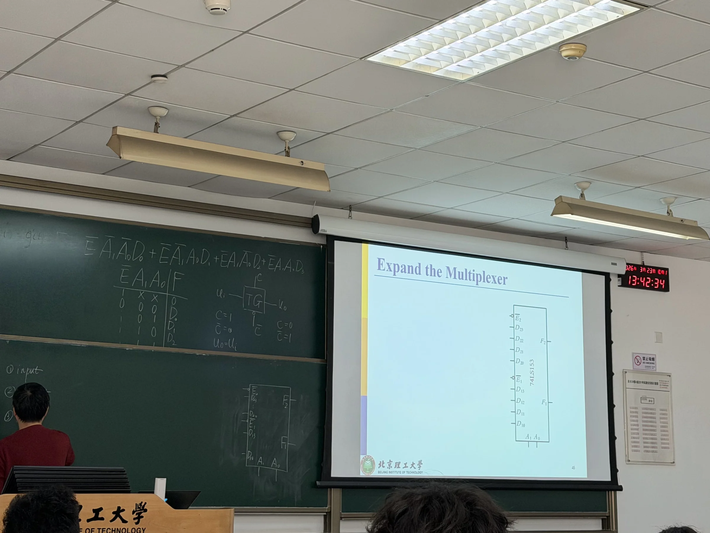
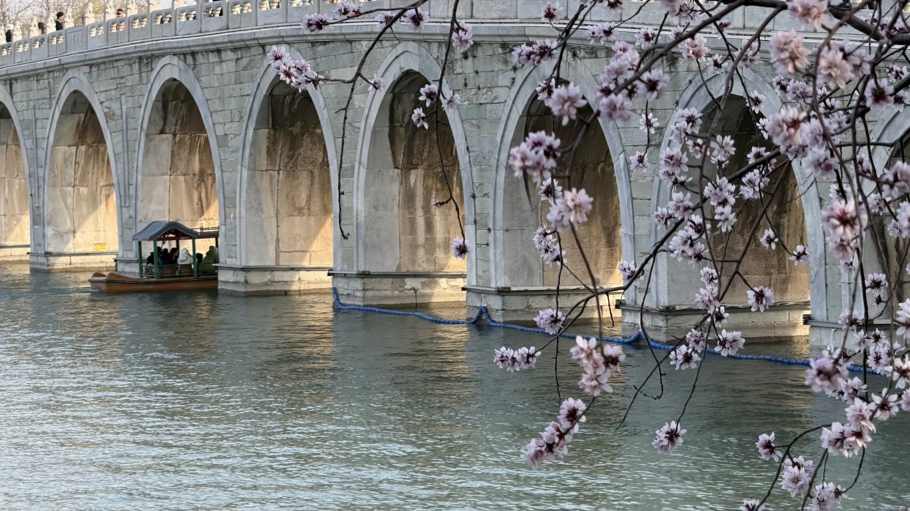

It's been just over a month since I arrived in Beijing to begin my exchange at Beijing Institute of Technology (北理工), and already the experience has transformed into something that genuinely feels like a cornerstone of my life. That transition from "visiting" to "living" has probably been the most defining aspect of this first month.

## From arrival to routine

The first week was just a whole lot of logistics and adjustment. Setting up a Chinese SIM card and bank account, figuring out payments, navigating unfamiliar apps, and learning how to do even the simplest tasks all took significantly more effort than I thought it would.

What stood out to me was the accumulation of small challenges. Tasks that would take seconds at home like ordering food, asking for directions, and buying essentials suddenly required thinking in a different language (and a lot of trial and error).

Now, a month in, those same tasks feel automatic. It has been a subtle but important change in difficulty - I believe it marks the point where adaptation starts morphing into routine.

## Life at Beijing Institute of Technology

Academically, BIT has been a very different environment compared to UTS. Classes are much more structured and formal, with less emphasis on casual interaction and discussion. 

However, the academic side has only been one part of the experience.

What has been more impactful is everything surrounding it: Living in a university environment, interacting with students from a wide range of cultural and academic backgrounds, and navigating daily life in a totally different system.

In many ways, my most meaningful learning has come from simply existing in a new environment, and learning how to operate within it.

## The reality of learning Chinese in China

Before arriving, I had completed around one year of Mandarin classes. While that provided a very strong foundation, applying it in real-world situations has been a completely different experience.

Everyday Mandarin is faster, less structured, and far less forgiving than what's taught in a class. Additionally, classes usually teach 普通话 (standard Chinese) but nobody really speaks it. Instead, each region of China varies by 'dialect' - luckily for me, 普通话 is primarily based on the Beijing dialect! However, the sheer amount of local slang and 儿话 still made it plenty difficult for me... unfortunately, conversations don't pause for you to think 😔

At the same time, being immersed in the language has made progress more tangible. Small improvements stand out: understanding sentences without needing repetition, successfully ordering food, asking questions and understanding answers, holding short conversations that achieve their purpose, and so on. These moments are minor individually, but collectively they feel like real steady progress.

## Systems, convenience, and friction

One of the most interesting aspects of life in Beijing has been the contrast between convenience and friction.

On one hand, the level of digital integration is extremely high. Apps handle almost every aspect of daily life: payments, transport, communication, food delivery, shopping, and anything else you could possibly think of is all seamlessly connected.

On the other hand, many of these systems are clearly not designed with foreign users in minds. This leads to plenty of moments where things unexpectedly break or become difficult to navigate.

This combination creates a unique dynamic: once something works, it's incredibly efficient, but getting to that point often requires patience and persistence.

## Independence in a new context

Living in Beijing has redefined what independence means.

At home, independence is often about managing responsibilities within a familiar system. Here, it's about learning how to function in a system that is entirely unfamiliar and not always intuitive. After coming here, I had to start from the very beginning to build my understanding of how local platforms and services operate, and adapt to different expectations and norms.

## The social experience

The social side of exchange has been less predictable than expected so far. Some days are highly social - meeting new people, going out, exploring the city, and so on. Other days are much quieter, with time spent alone reflecting or adjusting. I think this variability is a core part of the experience, though. Exchange isn't a constant stream of activity - it includes plenty of moments of uncertainty and adjustment, alongside the more exciting experiences.

## Looking ahead

After one month, I feel more settled, but still very much in the process of figuring things out. There are still clear goals for the coming months:

- Improving my Mandarin beyond my current conversational ability
- Exploring more of Beijing and other parts of China
- Building stronger routines and connections

More than anything, this first month has been about adaptation - learning how to navigate a new environment, becoming comfortable with uncertainty, and gradually building a sense of familiarity in a completely different context.
