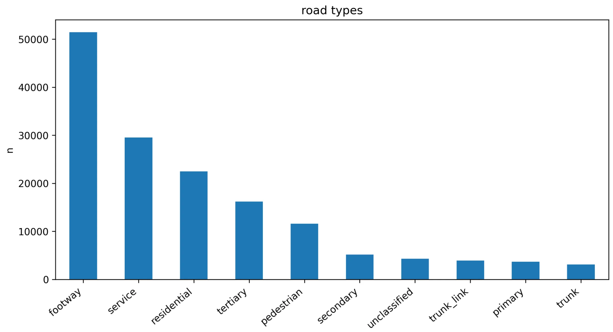

As a part of my Data Science class (at 北理工), I had to take a chunk of real-world geographic data and turn it into something much more structured: a fully routable road network.

Once I actually started working with the data, it became very clear that there's a lot more going on under the hood than I initially thought. At a high level, the task is just "turn roads into a graph", but in practice there are some (slightly painful) details that you have to get right before anything works properly.

## Turning map data into a graph

I used OpenStreetmap data for a chunk of Beijing (basically the area circled by the 3rd ring road) and loaded it into Python using `OSMnx`. From there, it becomes a `NetworkX` graph, where nodes = intersections and edges = road segments. Pretty standard graph theory stuff, but applied to something real.

One of the requirements was that every edge needed to have a road type and a length. `OSMnx` usually handles this, but I didn't FULLY trust it so I added a check anyway:

```python
for u, v, k, data in G.edges(keys=True, data=True):
  if "length" not in data:
    G = ox.distance.add_edge_lengths(G)
```

Real-world data is messy and I didn't want to have to debug it later when shortest paths started acting weird.

## Road types are messier than they look

The road type lives in the `highway` tag, and this is where the first surprise was. Most of the time it's a normal string like `"residential"`, but sometimes it's a **list**. When `OSMnx` simplifies the graph, it merges chains of small segments into one edge, and if those segments had different types, you get something like `["residential", "tertiary"]` back. Anything that expects a string then breaks.

My fix was to just take the first type in the list and give anything missing a fallback:

```python
for _, _, data in G.edges(data=True):
    h = data.get("highway", "unclassified")
    data["road_type"] = h[0] if isinstance(h, list) else h
```

Not perfect, but it meant every edge had exactly one type, which is what the rest of the pipeline needed.

Once that was sorted, I could actually look at what was in there:



The biggest category by far is `footway`, with over 50,000 edges. Footpaths, plus `service` roads (car park lanes, alleys, the little roads inside compounds) and `pedestrian` streets make up more than half the graph. The roads you'd actually think of as "Beijing's roads", like `trunk` and `primary`, are right down the bottom with only a few thousand edges each.

That doesn't mean big roads don't matter, it just means this chart counts **edges**, not distance. A trunk road like the 3rd ring itself is made of long segments, while a footpath network is chopped up into tiny pieces at every corner and doorway. If you plotted total length instead, the picture would look very different. It was a good reminder that the first chart you make isn't always measuring what you think it is.

## Making it actually routable

"Routable" just means you can ask the graph for a path between two points and get a sensible answer. A few things matter for that:

- **Direction.** `OSMnx` builds a `MultiDiGraph`, so one-way streets only go one way. Great for driving routes, but it also means some nodes can be reached from one direction and not the other.
- **Connectivity.** Cutting the map off at the 3rd ring leaves little bits of road hanging off the edge that don't connect back to anything. Those are fine to keep, but a shortest path query from inside one of them just fails.
- **Weights.** Shortest path needs to use `length` as the weight, otherwise `NetworkX` counts every edge as 1 and a route that's 200 tiny footpath segments loses to one that's five long road segments, even if it's twice as far.

The actual routing part ends up being pretty short once all of that is in place:

```python
orig = ox.distance.nearest_nodes(G, X=lon1, Y=lat1)
dest = ox.distance.nearest_nodes(G, X=lon2, Y=lat2)
route = nx.shortest_path(G, orig, dest, weight="length")
```

## What I took away from it

The algorithm was the easy part. Dijkstra is Dijkstra, and `NetworkX` handles it in one line. Most of the actual work was making sure the data going into it was consistent: every edge has a length, every edge has exactly one road type, and the graph is connected where it needs to be.

It's the same lesson I keep running into in data science subjects, just with roads this time. If you don't check your data before you trust it, your results will be wrong in ways that look completely reasonable, and that's way worse than a crash.
