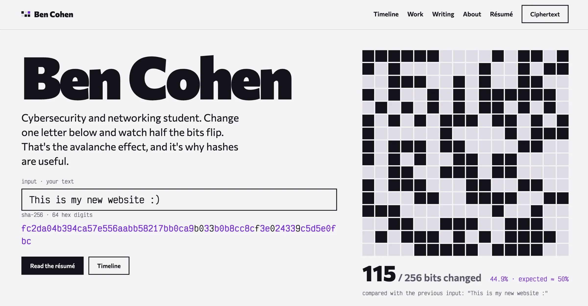
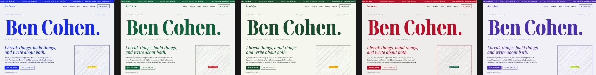
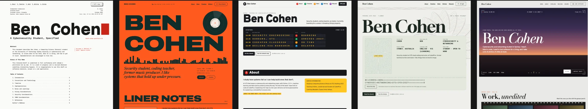
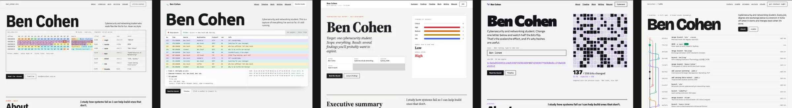
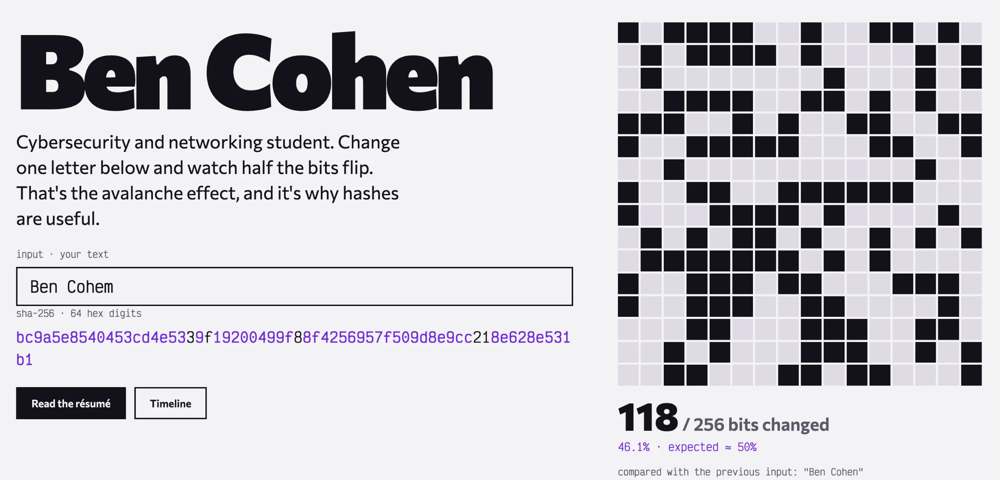
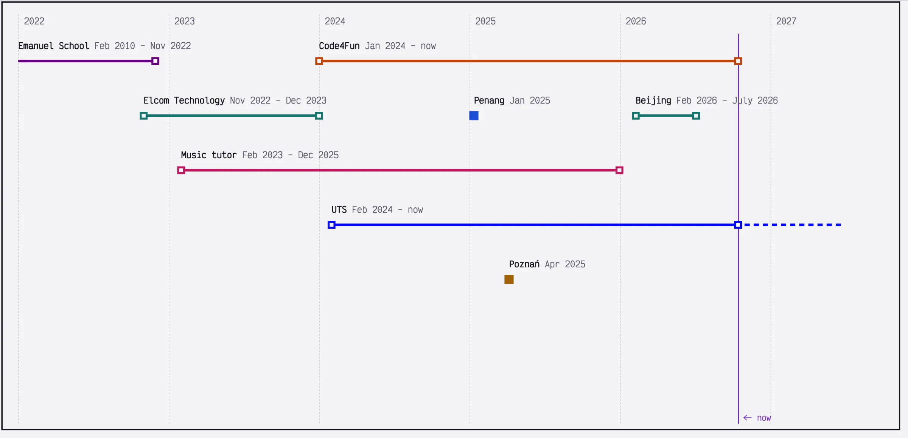
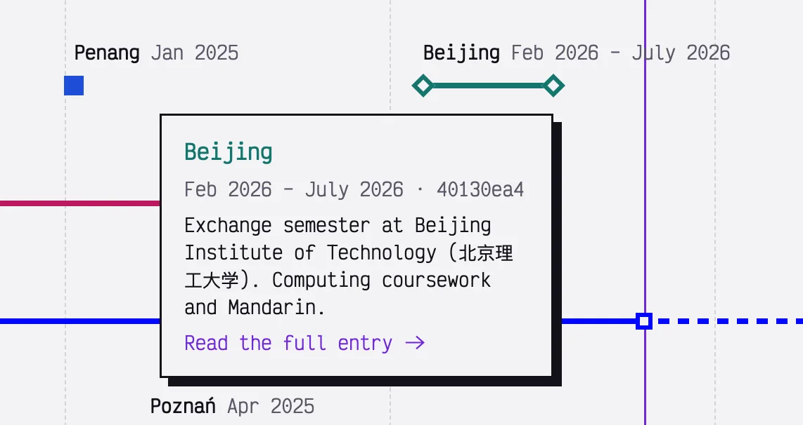
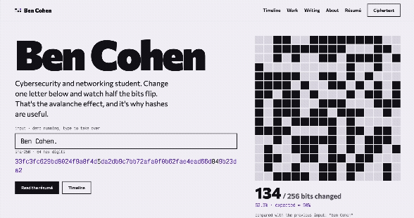

The old version of this site did its job, but it had started to bother me. It was a Next.js app with its own admin API and a contact form - there was a server running somewhere that I was responsible for keeping secure. As a cybersecurity student, I think it's quite backwards and ironic for the most exposed thing I own to be my own portfolio.

So, I rebuilt it! The goals were pretty simple:

### Static

No server, no database, no login form on the public site. Nothing to break into.

### Readable by bots

Recruiters run résumés and portfolios through ATS tools, so every page had to work as plain HTML, with JS disabled. My old site had a lot of modal content loaded in with JS, so that was a no-go.

### Still fun for people

Static doesn't have to mean boring!

### Basically free

The only thing I'm paying for here is the domain :)

## Finding a design

I didn't want it to look like every other developer portfolio (dark background, gradient blob, "Hi, I'm Ben 👋"). I went through a LOT of different directions before settling on one: terminal-style ones, editorial ones, ones that looked like an RFC document, and a few that were honestly just too much.

The one I picked is built around a single idea from cryptography: the [avalanche effect](https://en.wikipedia.org/wiki/Avalanche_effect).

### The hash demo

The thing at the top of the homepage is a live SHA-256 hash of whatever's in the input box. Change one character, and \~50% of the 256 output bits flip. That's the avalanche effect and it's a big part of why hashes are useful: tiny changes in the input give completely unrelated outputs, so you can't work backwards from a hash or nudge an input towards a target.

The demo cycles through a few variations based on my name on its own, and as soon as the user types in the box it switches to their input instead. The bit grid highlights every bit that flipped compared to the previous input, with a running count. It usually lands somewhere around 50%, which is exactly what you'd expect from a good hash.

The SHA-256 is a small implementation written straight into the site's JavaScript, because the browser's built-in crypto API is async and I wanted the demo to update on every keystroke without lag. I checked its output against Node's `crypto` module to make sure it was actually correct and not just plausible-looking hex.

### The timeline

The timeline might be my favourite part of the new site. Each entry is a coloured line from its start date to its end date, with a dot at each end. One-off things like the Penang and Poznań programs are a single dot. Hover over one for a quick summary, click it for the full page.

#### A few small details I'm happy with:

##### Rows are worked out automatically

When two entries overlap in time, the later one moves down a row, so I never have to manually arrange anything.

##### Ongoing entries grow by themselves

UTS and Code4Fun stretch up to a "now" marker that updates when the page loads, so the timeline would stay current even if I hypothetically went months without touching the site.

##### Dark mode lifts the colours

The same hex colour that looks good on a light background looks muddy and muted on a dark one, so in dark mode every entry gets automatically mixed with a bit of white.

### Ciphertext and Plaintext

The light and dark themes are called Plaintext and Ciphertext (dark is ciphertext, of course). Switching between them runs a pixel dissolve across the screen, and when the new theme appears, all the text on screen comes back as scrambled hex and decrypts itself left to right.
   

### Security

This was the part I cared about most.

**There's nothing on the server.** The site is plain HTML, CSS, and a bit of JavaScript, served from Github. There's no backend to attack, no database to leak, and no login form to brute force. 

**A very strict Content Security Policy.** Every page is sent with a header that tells the browser to only run scripts and load styles from this domain, and to block inline scripts and inline styles entirely. That shuts down most cross-site scripting attacks, because even if someone managed to inject a `<script>` tag into a page, the browser would refuse to run it.

The catch is that a policy that strict is easy to break by accident. Lots of tools sneak in an inline style here or there (the default code highlighter does, for example). So the build runs a check over every generated page and fails if it finds an inline script, an inline style, an `onclick`-style attribute, or anything loaded from another domain. That way, I can't deploy something that breaks the policy, even if I wanted to.

**No third-party requests.** The fonts are self-hosted there are no analytics and no trackers, and nothing on the public site talks to any other domain. You can check yourself in your browser's dev tools.

**The usual headers too:** `X-Frame-Options`, a locked down `Permissions-Policy`, `Cross-Origin-Opener-Policy`, and so on. If you want to check them yourself, put the site into [securityheaders.com](https://securityheaders.com/).

[SCREENSHOT OF SECURITY HEADERS RESULT]

**The build pipeline is locked down as well.** The GitHub Actions the site uses are pinned to exact commit hashes rather than version tags (tags can be moved to point at malicious code), dependencies are pinned and audited on every push, and automatic dependency updates wait a few days before they're proposed, so a freshly compromised package has time to get caught first. 

There's also a `security.txt` file, which is the standard place for someone to find out how to report a vulnerability. If you find something, please do!

## Writing posts without a backend

I still wanted an admin panel for writing posts and editing the timeline, but without a server. The solution I found was a Git-based CMS called Sveltia. It runs entirely in the browser at `/admin`, and when I save a post it commits a Markdown file straight to the site's GitHub repo. GitHub sees the commit, rebuilds the site, and it's live about a minute later.

Logging in uses my GitHub account, so the only way to edit the site is to have access to the repo. There's no separate password to steal, and no external login servers to rely on.

## Readable for people and robots

Everything important is in the HTML from the start. The résumé page is plain text with proper headings, there's a "for recruiters" box on the homepage with the key facts in a definition list, and every page includes structured data that tells search engines who I am. If you turn off JavaScript, you lose the fun animations but not a single piece of actual useful information.

## What's next?

The site is done in the sense that it works, but there's plenty more I want to put on it: more write-ups from uni, CTF write-ups, and a cybersecurity course I'm building for Code4Fun. The nice thing about it being this simple is that adding things is extremely easy, and there's very little that can go wrong.

If you've read this far and spotted something broken, or something insecure, [let me know](https://bencohen.com.au/.well-known/security.txt)!
