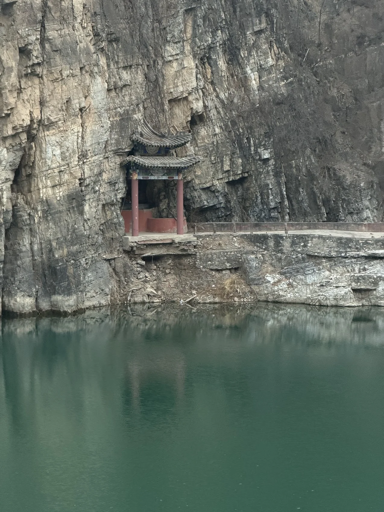

I spent the first half of 226 on exchange at Beijing Institute of Technology (北京理工大学), studying computing alongside local and international students. It was my first time living overseas, and probably the most I've learnt in a single semester, inside and outside the classroom.

# What I studied

My BIT subjects were heavier and theory and lower-level systems than what I'd done at UTS, which was exactly what I wanted.

## Compiler Principles and Design

First/Follow sets, LL(1) checks, and building LR(0) and LR(1) parsers by hand, then doing it properly with Flex and Bison. The final assignment extended a calculator grammar with unary, logical, and comparison operators and IF/ELSE conditionals, and built a parse tree for each input. This was the subject that changed how I read code. Once you've written a parser, every syntax error message suddenly makes a whole lot more sense.

## Computer Graphics

A C++ and OpenGL project. I created a clockwork orrery with planets on nested gears, plus a 20-page report. The two best lessons came from bus. One was a macOS build that couldn't find its headers. The other was lighting that looked completely wrong because I'd transposed the normal matrix (row-major vs column major). That one took FAR too long to find...

## Fundamentals of Digital Circuits

Combinational and sequential logic: K-maps, decoders, multiplexers, JK flip-flop counters and cascaded 74161 counters. The lab report covered a BCD discriminator, a voting circuit, and a traffic light sequencer. The usual simulator didn't run on my Mac, so I rebuilt the labs in CircuitVerse instead.

## Data Science and Algorithms

A group project predicting CitiBike demand in New York from 2.1 million real trips across 793 stations. We used a random forest with lag features and got the mean absolute error down to about 1.8 bikes per station-hour. We wrote it up as an ACM-format paper and presented it to the class.

## Machine Learning Fundamentals

A cancer diagnosis classifier comparing logistic regression, SVM, random forest, and KNN - with grid-search tuning and ROC curves. There was also a travel-time prediction task on a road network in Guiyang: around 26 million rows, LightGBM, and a lot of care to make sure no future data leaked into training.

# Living there

Outside of class, I was learning to live in Mandarin. Ordering food, sorting out the phone, getting around, and eventually being able to just chat with people. I wrote a separate post about that: [Six months of Mandarin in Beijing](/writing/six-months-of-mandarin-in-beijing-what-changed/). 

Some of my favourite places in Beijing:

- **什刹海、后海:** for walking around the lakes in the evening. There are always people singing karaoke on the streets, countless food and artisan craft stalls, fishers, and I love the way that it lights up at night!
- **南锣鼓巷** and the hutongs around it
- **景山公园:** the view straight down over the Forbidden City is crazy
- **北京动物园:** mostly for the pandas (obviously)
- **江湖酒吧:** A really nice & rustic bar built into a traditional 四合院, deep in the hutongs near 南锣鼓巷. There's always live music, and weekly jazz jam sessions!

# What I took away from it

## Fundamentals stick

Parsers, matrix maths, etc. all felt abstract at first, but they're what everything else is built on. They seem to come up constantly in security.

## Working in a second language

Group projects with people from different countries and backgrounds meant a lot of clarifying, rephrasing, and checking we meant the same thing. Incredibly useful for developing cross-cultural communication skills.

## Sorting things out alone

New city, new systems, new language, and nobody to hand problems off to. You get a lot more comfortable not knowing what's going on.

