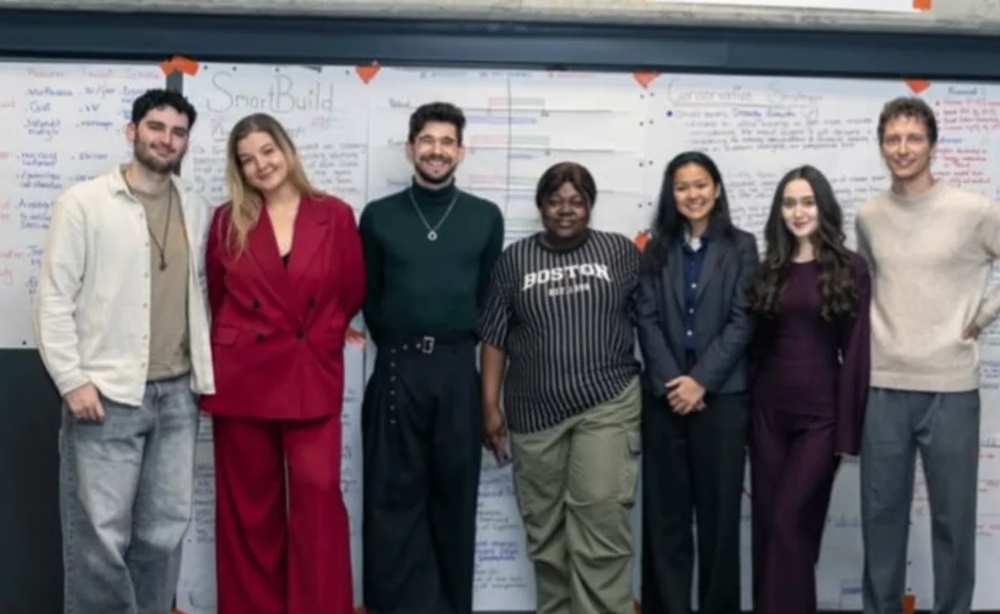
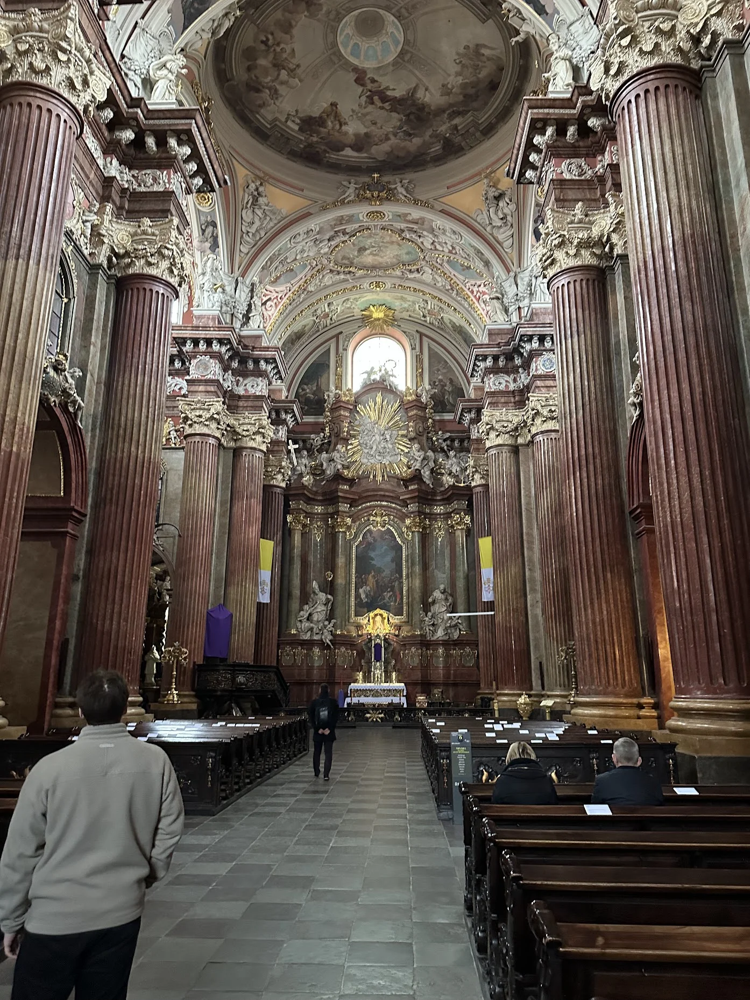

## Reflections on the International Strategic Management Workshop at Poznań University of Technology

A few days ago, I wrapped up the International Strategic Management Workshop at Poznań University of Technology (PUT), and I'm still taking in how much I learned from it. The program was part of a long-running collaboration between universities across the world, bringing students together to solve real strategic challenges while learning how culture and business intersect.

### Setting the Scene

The workshop was hosted by PUT's Faculty of Engineering Management in the city of Poznań, Poland. It's a week-long program that brings together students from different countries to work in mixed teams on a real-world business case. Each day combined lectures from professors with team sessions where we analysed data, developed strategies, and prepared presentations. The city itself made the experience even better! Poznań's old town, student life, and friendly locals made it a wonderful place to study.

### What the week looked like

We started with introductions and cross-cultural team-building sessions, then quickly moved into case work. Each team was given a company scenario that required strategic analysis and planning. We used tools like SWOT, Porter’s Five Forces, and PESTEL to break down the situation before brainstorming solutions. The days were long, but the energy stayed high because everyone was engaged and curious.

Working in such a diverse group was one of the highlights. Every person approached problems differently, shaped by their home country’s business culture and education. It wasn’t always easy to align, but that friction made the collaboration more rewarding. I learned how to communicate ideas more clearly, listen more actively, and find common ground in how we approached the project.

### Key takeaways

By the end of the week, I had a stronger grasp of how strategic management frameworks apply in practice. The final presentation was especially memorable. Standing in front of the panel to defend our strategy, I realised how much I'd learned and grown in just a few days. I was impressed with the increase in how confidently I could explain and justify the decisions of the team. I also came to appreciate how context shapes business strategy: what makes sense in one market might not in another.

### Why this experience matters

This program was more than just an academic exercise. It proved that I can adapt quickly, work under pressure, and collaborate effectively with people from different backgrounds. It strengthened both my analytical and interpersonal skills, and it gave me real-world experience applying strategic frameworks in an international context. It's something I'll definitely include in my portfolio as an example of global teamwork and applied business strategy.

### Looking ahead

I'll make sure to stay in touch with the friends and mentors I me during the week! Additionally, I'm taking what I learned about clarity, collaboration, and cultural awareness into everything I do next, whether that's future study or professional work.

Finishing this workshop felt like a turning point. It reminded me that strategy is about  real people, ideas, and the ability to think clearly in complex environments. I left Poznań feeling inspired, more confident in my skills, and ready to take on new challenges!

