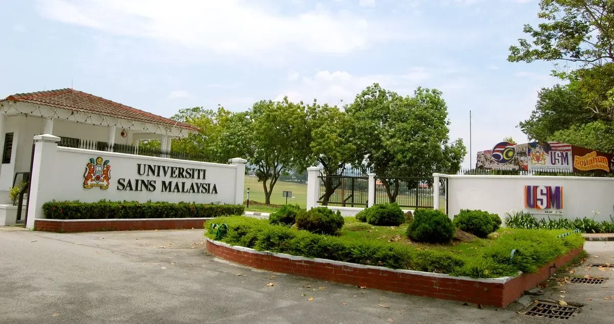
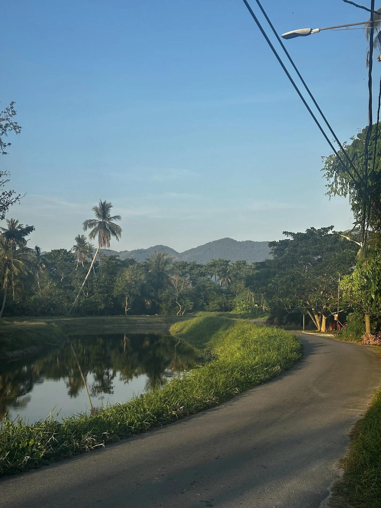
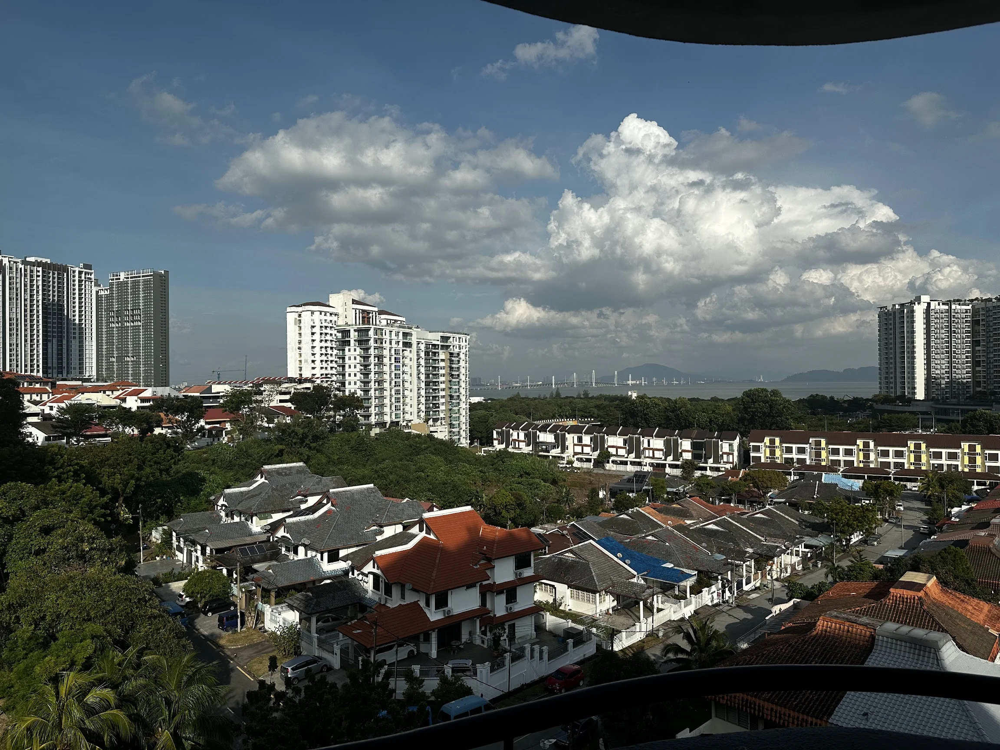

# Setting and context

The Tropical Data Science School hosted by the School of Computer Sciences and the International Mobility and Collaboration Centre at USM is designed for international students keen on diving into data science in a vibrant tropical setting. The program is paired with cultural immersion: you learn the technical side of data science while experiencing Penang's rich heritage, local food, and vibrant campus environment.

# What I learned

Over the course of the program I engaged in lectures, hands-on workshops, and a capstone-style group project. Key learning highlights include:

- Understanding the full data science workflow, from data collection/cleaning to modelling, visualisation, and storytelling.
- Deep dives into topics such as data visualisation, behavioural informatics, computational linguistics, and even blockchain as it applies to data contexts.
- Problem-solving through real-world case studies: working in teams, applying tools and techniques to data sets, then communicating findings clearly. The emphasis on _telling a story with data_ was recurrent.
- Cultural and team-building elements: beyond the classroom, I experienced excursions, peer engagement, and local immersion (which enriched the technical learning by grounding it in context!)

The combination of rigorous technical coverage and cross-cultural experience made for a holistic two weeks.

# Stand-out moments

- Working side-by-side with fellow students, each bringing different perspectives and background knowledge
- The group project - we took a messy real-world dataset, wrangled it, visualised key insights, and presented to our peers and mentors. That final presentation felt like a micro-consulting challenge and was a real test of confidence!
- One lecture on "Telling a Story with Data" made me rethink how I present my own analyses in future - I learned about how important it is to focus on clarity and impact rather than only prioritising accuracy.
- The setting!!! Being at USM on Penang Island with the lush campus, warm weather, and buzz of the local culture all contributed to the learning in unexpected ways
- The 'student buddy" support - local student volunteers who helped the international student participants settle in, navigate the city, socialise, and integrate. It made a big difference.

# Challenges & how I overcame them

- Initially, I felt a little outside my comfort zone. Terms like "behavioural informatics," "computational linguistics," and "blockchain for data science" didn't feel like my usual domain. But the instructors scaffolded these so that we built from foundational concepts and I found myself gaining traction.
- Time pressure. It's an intensive program, and participants have a relatively short time frame for learning, working, socialising, and exploring the island. I managed by being disciplined about setting aside specific times for content review and collaborating well with my group and other peers.
- Cultural/context shift: though Malaysia and Penang are very accessible, being in a new environment means adjusting to local rhythms, food, transport, etc. I embraced it (and the local meals!) which helped me settle faster. I ate A LOT of roti canai and laksa 😋

# Why this experience matters

- **Global perspective in data science:** participating in an international short program shows I'm comfortable in cross-border and diverse settings - increasingly important in globalised data work
- **Demonstrated ability to learn intensively:** the TDSS format is compressed and intense, and completing it successfully shows that I can adapt, learn fast, and perform in high-pace environments.
- **Hands-on project experience:** the capstone project is something I can talk about concretely - what the problem was, what my role in the team was, what tools I used, what insights we found, and what the implications were. That makes a strong talking point!
- **Soft skills and collaboration:** working with a wide variety of students, presenting findings, being mentored, and managing the workload. All of these things are super important skills for team-based data analysis
- **Cultural agility:** immersing myself in Penang, experiencing local culture while studying data science adds an extra dimension to my profile that goes beyond pure technical ability

# Final thoughts

Finishing the TDSS program at USM feels like a real milestone: it's both a technical step-up and a real experience of personal enrichment. I came away with new tools, knowledge, and a deeper appreciation for how data science operates in real-world, cross-cultural contexts, how storytelling matters, and how teamwork and diversity enhance outcomes. I'm excited to carry this forward, into further study, into my next internship or role, and into wherever data and global contexts meet.

